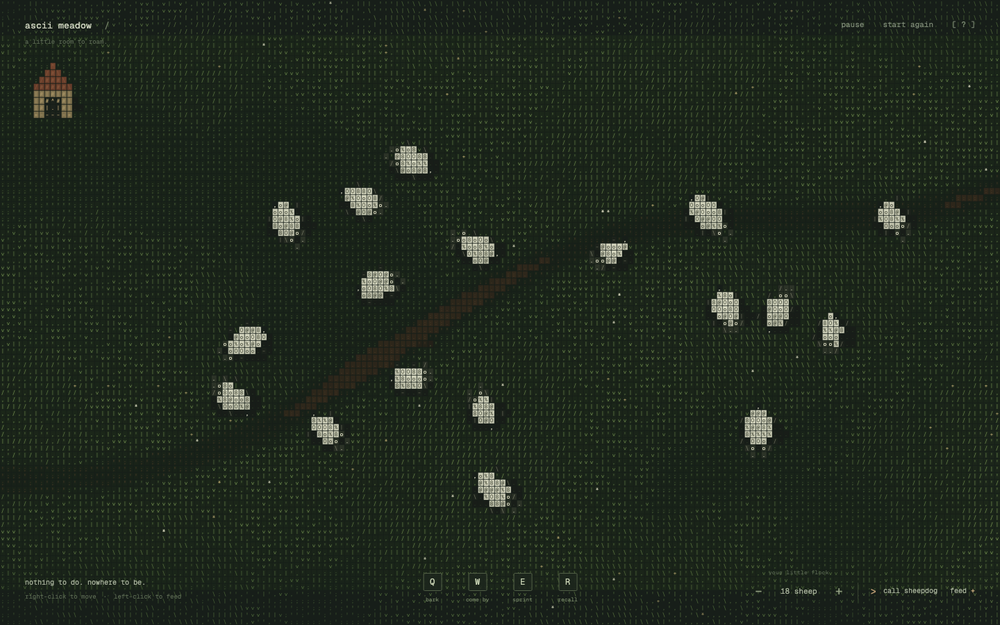

# ASCII Meadow

A little room to roam. A full-screen meadow of grass, clover, tiny flowers and sheep, drawn entirely with ASCII glyphs. Sheep graze, leave eaten patches, move on to greener grass and follow scattered feed. Call a small sheepdog and guide the flock with point-and-click movement and four abilities.



## Run

```sh
npm install
npm run dev
```

Run these from this directory. Open the Vite URL, normally `http://127.0.0.1:5176`. Node 22 LTS or 24+ is recommended. The app uses TypeScript, Vite and Canvas 2D, with zero runtime dependencies. It has no server, accounts, external assets, React or WebGL. The font is bundled locally.

```sh
npm run test          # deterministic simulation tests
npm run test:browser  # desktop and mobile Playwright checks
npm run build        # strict TypeScript check + production output in dist/
npm run preview      # serve production output on port 4176
```

If Playwright's browser is missing, run `npx playwright install chromium` once. Browser tests expect this project on port 5176.

## Sheepdog controls

**Right-click to move the dog. Left-click to drop feed.** A food click never calls or redirects the dog. Hold the right mouse button to keep updating the destination. A small green mark shows the command. Movement interrupts automatic circling or recall.

All four actions can be used again immediately: **there are no cooldowns**.

| Key | Ability | What happens |
| --- | --- | --- |
| **Q** | **Bark** | Every sheep flees from the dog's position for six seconds. Expanding ASCII rings carry the bark across the field. Recasting refreshes the escape. |
| **W** | **Come By** | The dog exits to the outer boundary, then makes a complete lap around the padded envelope of **every** sheep, including edge strays. The route updates as the flock moves. |
| **E** | **Sprint** | A short sprint toward its current destination. When idle, the dog sprints toward the cursor. |
| **R** | **Recall / Release** | First press: return to the barn-style doghouse in the corner. Next press: sprint all the way to the cursor, with no click required. The second press also works while the dog is on its way home. |

The bottom-right dog button calls the dog, then offers the same recall/release action as R. An idle dog dozes after seven seconds and releases drifting `z`/`Z` glyphs. Movement or an ability wakes it immediately. A sleeping dog, or a dog in its house, leaves nearby grazers alone.

## Feeding and other controls

| Control | Effect |
| --- | --- |
| **Left-click** | Drop a handful of feed without moving the dog |
| **F** or **feed +**, then click / tap | Place feed, including on touch screens |
| **Right-click** | Move the dog; hold to keep updating its target |
| Touch: tap / hold | Tap to move the dog; hold and release to feed, or use feed + |
| **+ / −** in the bottom-right | Add or remove one sheep, from 0 to 80 |
| **Space** or **pause** | Pause / resume the entire meadow |
| **start again** | Fresh grass and sheep with the current count |
| **H** | Hide / show the interface |
| **Escape** | Close help, cancel feed placement, show the interface |
| **[ ? ]** | Open the compact control guide |

Food is shared and slowly consumed, with up to ten handfuls lasting up to 120 seconds. The sheep count persists in localStorage; the app works if storage is blocked. All other simulation state is temporary.

## A gentler pace

Ordinary sheep walk at 8–13 CSS pixels per second. Food attracts them at about 1.35 times that pace. Being chased raises their speed modestly, with a 26 px/s cap. Q is the deliberate exception: its six-second fright allows a sustained escape up to 64 px/s.

The dog walks at 62 px/s (previously 190), makes its outside lap at 94 px/s, sprints with E at 185 px/s, and launches from recall at 205 px/s. These speeds scale down on smaller screens. Grass is eaten about 71% more slowly than before, and sheep linger longer over each patch.

## A living pasture

Each visible character belongs to a grass tile. Tiles store grass quantity, a local growth capacity, soil, wildflowers and temporary flattening. Sheep eat nearby tiles while grazing; fresh grass is a lighter green, cropped grass darkens, and depleted cells show sparse punctuation over warm brown earth. Both glyphs and subtle tile washes express how much grass remains. They periodically choose a new patch by comparing nearby grass quality and crowding. Grass slowly regrows toward the local capacity over roughly two to four minutes, and flattened blades recover over a few seconds. Slow wind bends longer grass without random per-frame flickering. A winding path and darker/lighter clover patches come from seeded procedural terrain.

Sheep have different sizes, speed, courage, wool texture and grazing rhythms. A wider personal-space zone and two passes of soft collision correction reduce piling up while permitting a little wool overlap. Heads and ears have their own rendering priority and are drawn after all bodies, so wool cannot hide another sheep’s face. A nearby dog interrupts grazing and pushes sheep away; neighbors share some of that movement. Bark triggers a sustained flock-wide escape. Come By follows the actual outside envelope instead of an average-radius circle, with an outside lane reserved for the dog at all pasture edges.

The visual style carries forward ASCII Pond's bundled Geist Mono, small character grid, inset glyph tiles and restrained colors. Wool is rasterized as a softly shaded oval of cream tiles with body-anchored glyphs, dark faces, ears, tails and little moving legs. The smaller collie has a copper coat and pale chest. Everything is Canvas text and character tiles; no animal images, SVG sprites or emoji are used.

## Implementation

```text
src/
  simulation/Pasture.ts   retained grass, consumption, regrowth and trampled paths
  simulation/World.ts    sheep, food, movement, herding and ability clocks
  engine/Renderer.ts     cached glyph atlas, grass, sheep, collie, rings and markers
  interaction/Controller.ts  pointer/touch, shortcuts, ability UI and flock controls
  vendor/pond-math.ts    attributed helpers reused from ASCII Pond
  main.ts               fixed-step loop, resize and visibility handling
```

Physics runs at 60 fixed steps per second, with bounded catch-up. Typed arrays store the pasture. A device-pixel-aware atlas caches characters and colors. The app stops drawing in a hidden tab and starts paused when reduced motion is requested. Resize preserves grass and creature state, including an active outside lap or recall destination.

## Verification and limits

The project includes simulation tests and desktop/mobile Chromium browser tests. See [docs/VALIDATION.md](docs/VALIDATION.md) for results and frame samples. Screenshots are real browser captures.

Herding is a gentle simulation, not a professional livestock model. At high populations sheep can crowd, especially in a small viewport. Movement is continuous, while the glyph silhouettes occupy discrete grid cells. Physical mobile devices and Safari have not been tested; mobile validation uses Chromium device emulation. Bark is visual and does not play audio. The project remains local and has not been deployed.

## Attribution

See [ACKNOWLEDGMENTS.md](ACKNOWLEDGMENTS.md). ASCII Pond's MIT notice and the Geist Mono SIL OFL license are included with the source and production build.
